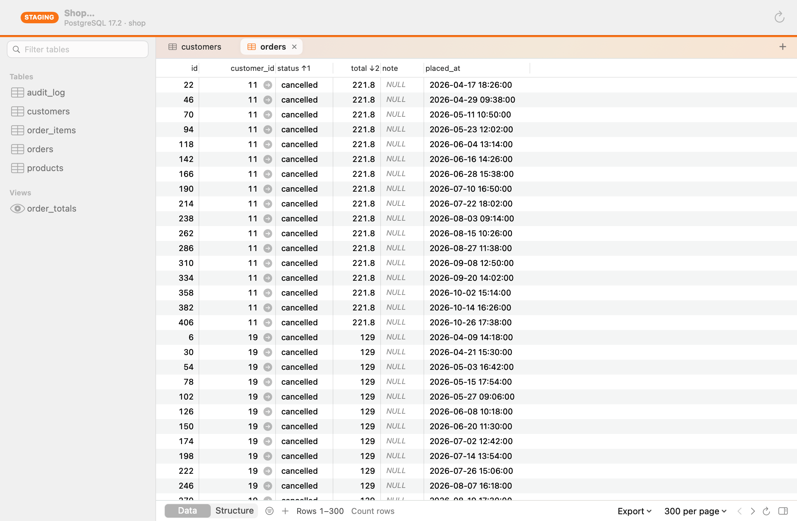
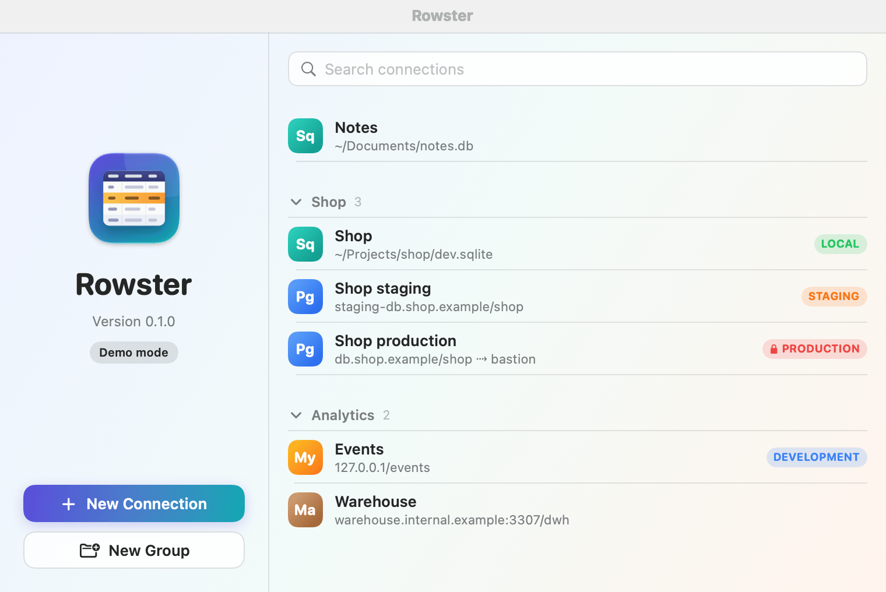
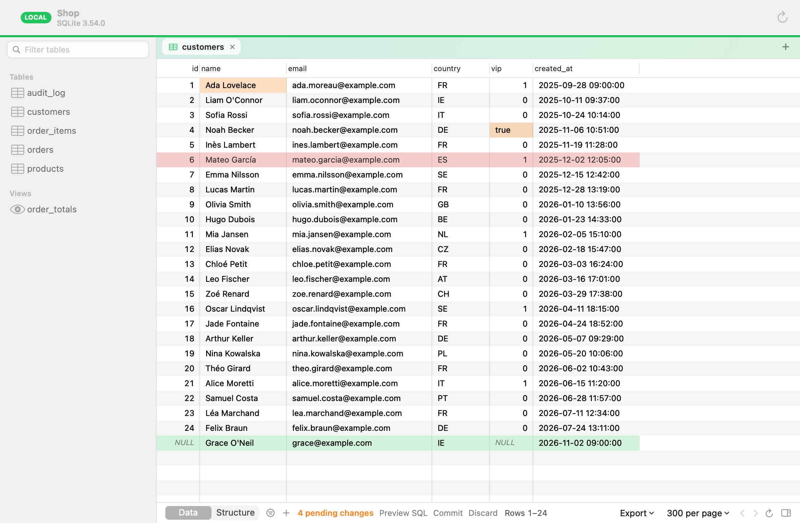
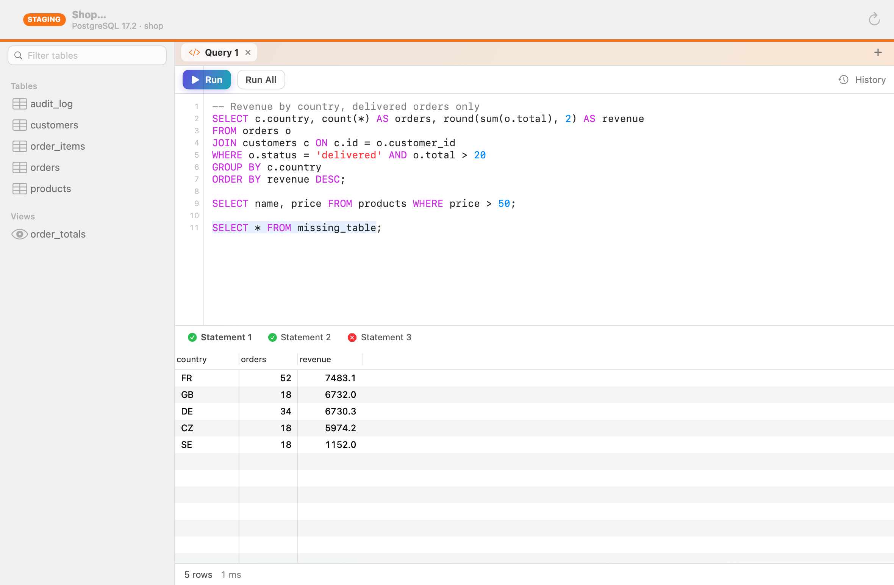
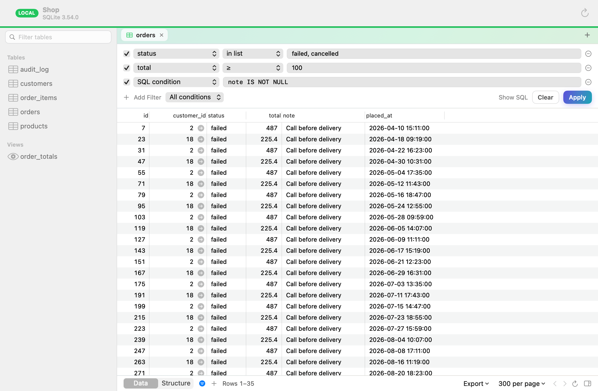
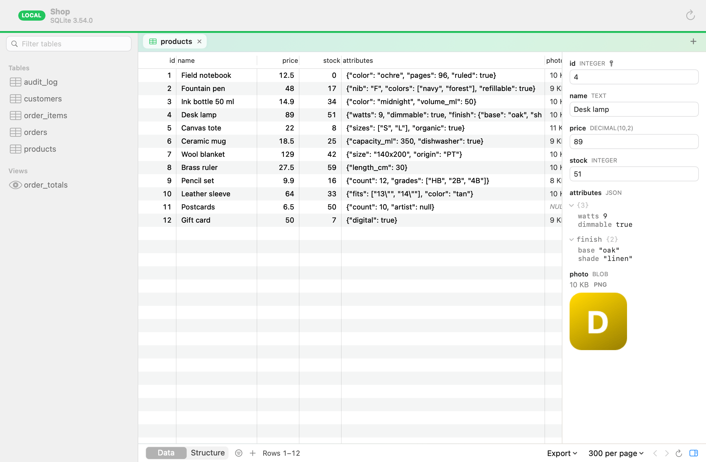
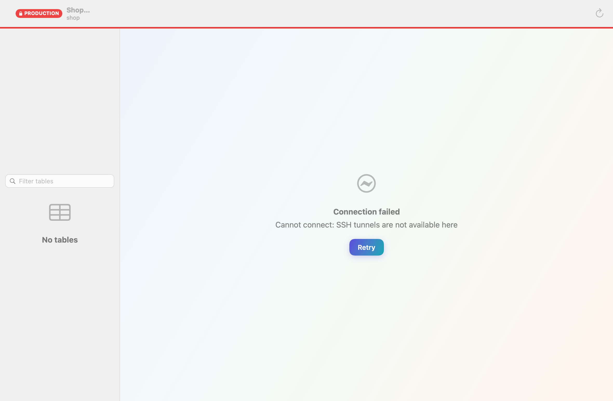
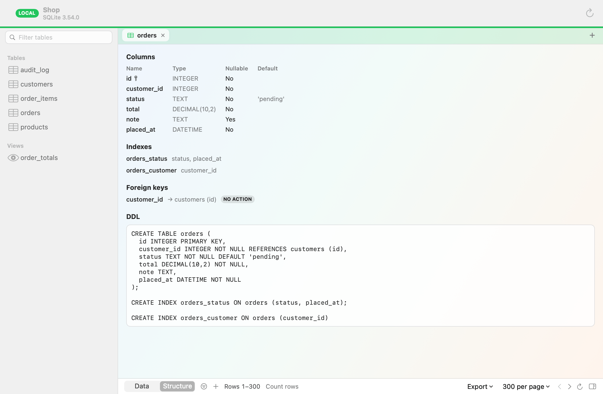

<p align="center">
  
</p>

<h1 align="center">Rowster</h1>

<p align="center">A native, free and open-source database client for macOS, with safety built in.</p>

<p align="center"><a href="README.fr.md">Version française</a></p>

<picture>
  <source media="(prefers-color-scheme: dark)" srcset="docs/images/data-grid-dark.png">
  
</picture>

Rowster browses, filters, edits and queries PostgreSQL, MySQL, MariaDB and SQLite databases. It is written in Swift, with its own drivers: no bundled C library, no Electron. There is no limit on tabs, windows or filters, and nothing to pay.

## Status

Version 0.1 is built and tested, and has no published release yet: build it from the sources (see below). What it contains is listed here; what was left for later is in [Limits](#limits-of-01).

## Features

- **PostgreSQL, MySQL, MariaDB and SQLite**, with drivers written in Swift on Network.framework. Servers that speak the PostgreSQL protocol should work as far as they implement it.
- **TLS** in five modes, from disabled to full verification, with an optional CA file.
- **SSH tunnels** through the system OpenSSH: your `~/.ssh/config`, agents (1Password, Secretive) and ProxyJump apply as they do in a terminal. Passphrase and host-key questions are asked in the app.
- **Data grid**: 300 rows per page by default, a multi-column sort remembered per table, column widths remembered, BLOBs shown by their size and loaded on demand.
- **Filter bar** (⌘F): as many conditions as you want, a search across every column, a hand-written SQL condition, and *Show SQL*.
- **Row inspector** (⌥⌘I): every value of a row, a foldable tree for JSON, an image or hex preview for binary values.
- **Foreign keys**: an arrow opens the referenced row; hovering it previews that row.
- **Pending changes**: edits are highlighted, previewed as SQL (⇧⌘P), then committed in one transaction (⌘S).
- **SQL editor**: highlighting per engine, run the statement under the cursor (⌘↩) or everything (⇧⌘↩), one result per statement, cancellation, a searchable history.
- **Structure**: columns, indexes, constraints and DDL.
- **Export** to CSV and JSON, written as a stream; copy rows as CSV, JSON, Markdown or `INSERT` statements.
- **Environment labels and colors**, with production opened read-only.
- English and French.

## Screenshots

<p align="center">
<picture>
  <source media="(prefers-color-scheme: dark)" srcset="docs/images/welcome-dark.png">
  
</picture>
</p>

<p align="center">
<picture>
  <source media="(prefers-color-scheme: dark)" srcset="docs/images/pending-changes-dark.png">
  
</picture>
</p>

<p align="center">
<picture>
  <source media="(prefers-color-scheme: dark)" srcset="docs/images/editor-dark.png">
  
</picture>
</p>

<p align="center">
<picture>
  <source media="(prefers-color-scheme: dark)" srcset="docs/images/filters-dark.png">
  
</picture>
</p>

<p align="center">
<picture>
  <source media="(prefers-color-scheme: dark)" srcset="docs/images/inspector-dark.png">
  
</picture>
</p>

<p align="center">
<picture>
  <source media="(prefers-color-scheme: dark)" srcset="docs/images/unlocked-dark.png">
  
</picture>
</p>

<p align="center">
<picture>
  <source media="(prefers-color-scheme: dark)" srcset="docs/images/structure-dark.png">
  
</picture>
</p>

## Safety

- **No write happens without you seeing the SQL.** Changes made in the grid wait until you commit them, in one transaction that is rolled back whole if anything fails.
- **Production is read-only.** A connection labelled production opens read-only, on the server and in the app, and its color is visible everywhere. Writing is unlocked for one window at a time, after a confirmation and, if you turn it on, Touch ID.
- **Destructive statements are confirmed**: `DROP`, `TRUNCATE`, and `DELETE` or `UPDATE` without `WHERE`, shown in full.
- **Results are bounded**, and every statement can be cancelled.
- **Values are never part of the SQL** Rowster generates: they are bound parameters.
- **Passwords are in the Keychain only.** The file that lists your connections contains none.
- **No telemetry.** Rowster only contacts the databases and SSH hosts you configure.

The read-only mode protects against accidents; its limits are described in [SECURITY.md](SECURITY.md).

## Build from source

Requirements: macOS 14 or later, Xcode 16 or later, and XcodeGen (`brew install xcodegen`).

```sh
git clone https://github.com/romainrg/Rowster.git
cd Rowster
make run     # or: make demo, to try it with a sample database and no network
```

See [CONTRIBUTING.md](CONTRIBUTING.md) for the other commands.

## Limits of 0.1

- Builds are signed ad hoc: macOS asks again for access to each saved password after an update, and Gatekeeper needs *Open Anyway* on first launch.
- The editor has no completion yet, and a value with several lines cannot be edited in the grid.
- No TLS client certificates, no Kerberos, no MariaDB `ed25519` authentication.
- Structure is read-only.

## Roadmap

- **0.2**: editor completion, Redis, a built-in read-only MCP server, saved queries, Open Anything (⌘P), CSV import, process list, visual `EXPLAIN`.
- **0.3**: assistant panel, structure editing, ClickHouse, libSQL/Turso, Cloudflare D1, SQL Server.
- Later: Developer ID signing and notarization.

## Contributing

Contributions are welcome: read [CONTRIBUTING.md](CONTRIBUTING.md). Security reports go through [SECURITY.md](SECURITY.md). The architecture is described in [docs/ARCHITECTURE.md](docs/ARCHITECTURE.md).

## License

[MIT](LICENSE) © 2026 Romain Gallien
