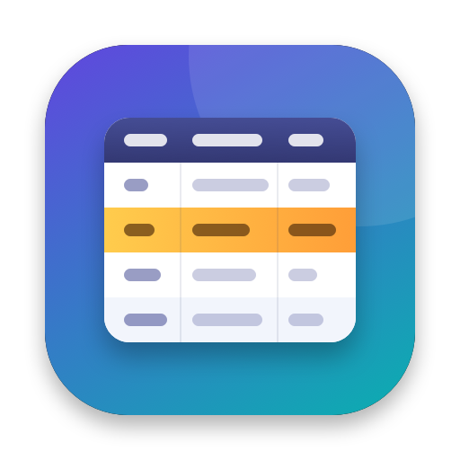

<p align="center">
  
</p>

<h1 align="center">Rowster</h1>

<p align="center">A native, free and open-source database client for macOS, with safety built in.</p>

<p align="center"><a href="README.fr.md">Version française</a></p>

## Status

Rowster is in development and has no release yet. Version 0.1 is specified in [docs/specs/0.1.md](docs/specs/0.1.md) and built increment by increment following [docs/plans/0.1.md](docs/plans/0.1.md).

## Features

Planned for 0.1:

- **PostgreSQL, MySQL/MariaDB and SQLite**, with native drivers written in Swift: no bundled C library, no Electron.
- **TLS and SSH tunnels** through the system OpenSSH, so `~/.ssh/config`, agents and ProxyJump just work.
- **Data grid** with paging, a filter bar, a multi-column sort remembered per table, and a row inspector (form, JSON tree, BLOB preview).
- **Pending changes**: edits are highlighted, previewed as SQL, then committed in one transaction.
- **SQL editor** with one result tab per statement, cancellation and a searchable history.
- **Environment labels and colors**, with production opened read-only.
- No limit on tabs, windows or filters. English and French.

## Safety

- No write happens without you seeing the SQL first.
- A connection labelled production opens read-only, and its color is visible everywhere.
- `DROP`, `TRUNCATE`, and `DELETE` or `UPDATE` without `WHERE` are confirmed.
- Results are bounded and every query can be cancelled.
- Passwords are stored in the Keychain only. No telemetry: Rowster only contacts the databases and SSH hosts you configure.

## Build from source

Requirements: macOS 14 or later, Xcode 16 or later, and XcodeGen (`brew install xcodegen`).

```sh
git clone https://github.com/romainrg/Rowster.git
cd Rowster
make run     # or: make demo, to try it with a sample database
```

See [CONTRIBUTING.md](CONTRIBUTING.md) for the other commands.

## Roadmap

- **0.1**: PostgreSQL, MySQL/MariaDB, SQLite; grid, filters, inspector, pending changes; editor; read-only production; CSV and JSON export.
- **0.2**: Redis, a built-in read-only MCP server, saved queries, Open Anything (⌘P), CSV import, process list, visual `EXPLAIN`.
- **0.3**: assistant panel, structure editing, ClickHouse, libSQL/Turso, Cloudflare D1, SQL Server.
- Later: Developer ID signing and notarization.

## Contributing

Contributions are welcome: read [CONTRIBUTING.md](CONTRIBUTING.md). Security reports go through [SECURITY.md](SECURITY.md).

## License

[MIT](LICENSE) © 2026 Romain Gallien
